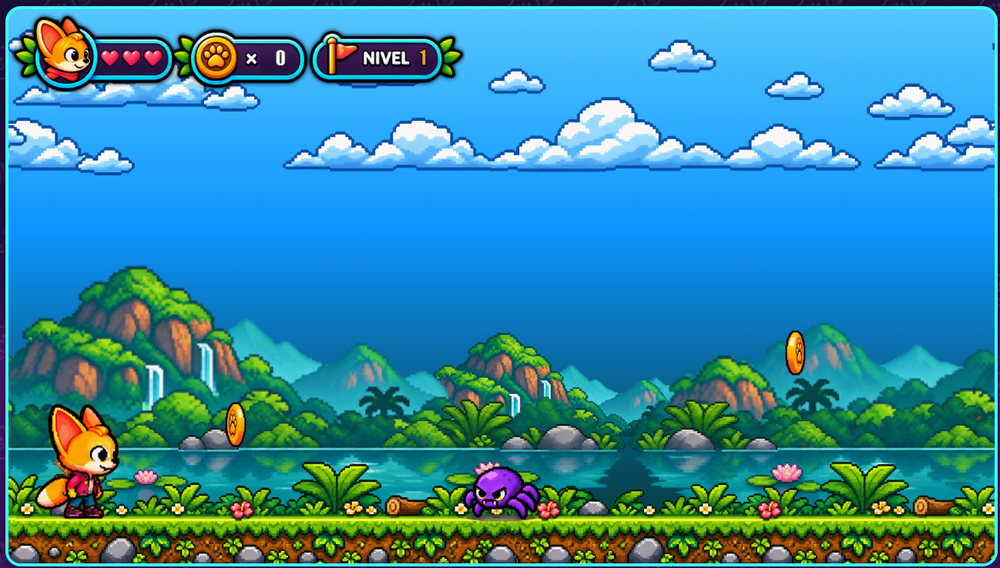
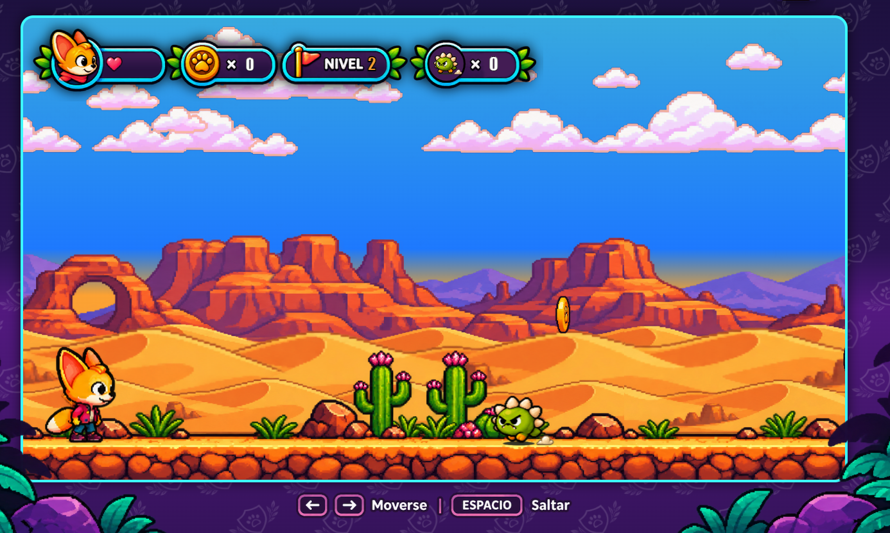
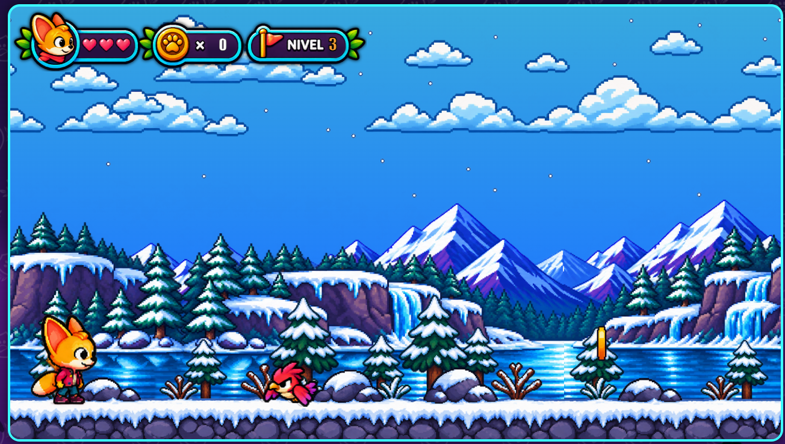

# El escudo LDA
## Los detectives de mascotas

**Videojuego de plataformas 2D desarrollado con JavaScript vanilla y HTML5 Canvas.**

El escudo LDA es un videojuego de plataformas de desplazamiento lateral en el que elegimos entre dos mascotas detectives para recorrer tres escenarios: una jungla, un desierto y una montaña nevada.

El objetivo es recoger las diez huellas doradas de cada nivel, esquivar o derrotar a los enemigos y completar la aventura conservando al menos uno de los tres corazones disponibles.

El proyecto combina desarrollo frontend, programación orientada a objetos, animaciones mediante spritesheets y escenarios con efecto parallax, junto con una identidad visual inspirada en los videojuegos clásicos de estética pixel art.

### Características principales

- Selección entre dos personajes jugables con animaciones propias y las mismas mecánicas.
- Tres niveles con escenarios, enemigos y dificultad progresiva.
- Movimiento lateral, salto y colisiones.
- Sistema de vidas persistentes entre niveles.
- Coleccionables y progresión por objetivos.
- Animaciones de personajes y enemigos mediante spritesheets.
- Escenarios multicapa con efecto parallax.
- Efectos de sonido, música y control de audio.
- Pantallas de inicio, transición, victoria y Game Over.

## Demo y capturas

### Juega online

El videojuego puede ejecutarse directamente desde el navegador, sin necesidad de instalar dependencias.

**[Jugar a El escudo LDA](URL_DE_GITHUB_PAGES)**

### Capturas del videojuego

Una pequeña muestra de los escenarios y la identidad visual del proyecto.

| Jungla — Nivel 1 | Desierto — Nivel 2 | Montaña nevada — Nivel 3 |
|---|---|---|
|  |  |  |

## Tecnologías utilizadas

El videojuego está desarrollado con tecnologías web nativas, sin frameworks ni librerías externas.

| Tecnología | Aplicación en el proyecto |
|---|---|
| **HTML5** | Estructura de la página e integración del videojuego. |
| **CSS3** | Estilos de la interfaz, distribución de elementos y controles visuales. |
| **JavaScript (ES6+)** | Lógica del juego, programación orientada a objetos, gestión de eventos y estados. |
| **Canvas API** | Renderizado 2D de escenarios, personajes, animaciones y elementos del juego. |
| **HTMLAudioElement (Audio API)** | Reproducción de música y efectos de sonido mediante objetos `Audio`. |

El proyecto utiliza una arquitectura basada en clases, con responsabilidades diferenciadas para la gestión de la partida, los personajes, los enemigos, los escenarios y los recursos multimedia.

## Cómo jugar

Elige entre las dos mascotas detectives antes de comenzar la partida y supera los tres niveles de la aventura, recogiendo huellas doradas y evitando los peligros de cada escenario.

### Selección de personaje

Tras la pantalla de bienvenida, elige **Player 1** o **Player 2** para comenzar la aventura. Ambos personajes comparten los mismos controles y mecánicas, pero tienen sprites y animaciones propios. La elección se mantiene durante los tres niveles.

### Controles

| Tecla | Acción |
|---|---|
| `←` | Moverse hacia la izquierda |
| `→` | Moverse hacia la derecha |
| `Espacio` | Saltar |

### Objetivo

- Recoge **10 huellas doradas** para completar cada nivel.
- Esquiva a los enemigos o derrótalos saltando sobre ellos.
- Dispones de **3 corazones** para completar toda la aventura.
- Cada golpe recibido resta un corazón y proporciona unos segundos de invulnerabilidad.
- Los corazones restantes se conservan al avanzar al siguiente nivel.
- Si pierdes todos los corazones, la partida termina y tendrás que comenzar de nuevo.

### Niveles

| Nivel | Escenario | Enemigo |
|---|---|---|
| 1 | Jungla tropical | Araña morada |
| 2 | Desierto | Monstruo verde |
| 3 | Montaña nevada | Pájaro rojo |

Cada nivel presenta un escenario diferente y enemigos con velocidades progresivamente mayores.

Completa los tres niveles para llegar al final de la aventura.

## Arquitectura y organización del código

El videojuego utiliza una arquitectura basada en programación orientada a objetos (POO), con una separación de responsabilidades entre la lógica de la partida, las entidades del juego, los escenarios y los recursos multimedia.

### Clases principales

| Clase | Responsabilidad |
|---|---|
| `Game` | Coordina el ciclo principal del juego, la selección de personaje, los niveles, las colisiones y las transiciones entre estados. |
| `Player` | Gestiona el movimiento del personaje seleccionado, los saltos, las animaciones y los estados de invulnerabilidad. |
| `Enemy` | Controla el movimiento, las animaciones y el estado de los enemigos de cada nivel. |
| `Coin` | Representa los coleccionables y gestiona su movimiento y animación. |
| `Scenary` | Renderiza las capas de los escenarios y gestiona su desplazamiento para crear el efecto parallax. |
| `AudioManager` | Centraliza la reproducción de música, efectos de sonido y controles de audio. |

### Utilidades y configuración

- **`image-loader.js`:** proporciona la función `loadImage()`, que centraliza la creación y carga de los recursos gráficos.
- **`constants.js`:** reúne los valores de configuración del videojuego, como dimensiones, velocidades, spritesheets, controles y parámetros de los niveles.
- **`index.js`:** inicializa el videojuego y conecta su ejecución con la página HTML.

### Organización de archivos

```text
game/
├── assets/
│   ├── audio/
│   ├── bgn/
│   ├── enemies/
│   ├── player/
│   └── ui/
├── css/
│   ├── reset.css
│   └── style.css
├── js/
│   ├── constants.js
│   ├── index.js
│   ├── models/
│   │   ├── audio-manager.js
│   │   ├── coin.js
│   │   ├── enemy.js
│   │   ├── game.js
│   │   ├── player.js
│   │   └── scenary.js
│   └── utils/
│       └── image-loader.js
└── index.html
```

Esta organización permite mantener diferenciadas las responsabilidades de cada componente y facilita la evolución del videojuego sin concentrar toda su lógica en un único archivo.

## Decisiones técnicas destacadas

Durante el desarrollo del videojuego se han aplicado diferentes soluciones para organizar la lógica, gestionar las interacciones y mantener separadas las responsabilidades de sus componentes.

### Ciclo de juego y gestión de estados

La clase `Game` centraliza el ciclo principal de ejecución, encargado de actualizar y dibujar los elementos, generar enemigos y coleccionables, comprobar colisiones y gestionar las transiciones entre niveles.

El juego contempla diferentes estados, como la pantalla de inicio, la selección de personaje, la partida activa, los niveles completados, Game Over y el final de la aventura.

### Selección y reutilización de personajes

`Game` crea la instancia de `Player` cuando se elige un personaje. Las rutas de los sprites de cada opción se definen en `PLAYER_CONFIG`, dentro de `constants.js`, y se pasan al constructor de `Player`. Ambos personajes comparten la lógica de movimiento, salto y colisiones. La misma instancia se reutiliza entre niveles, conservando la elección inicial.

### Animaciones mediante spritesheets

Los personajes, enemigos y coleccionables utilizan spritesheets para representar sus animaciones.

La selección de fotogramas se gestiona mediante índices de filas y columnas, mientras que las dimensiones de los spritesheets y las frecuencias de animación se definen en `constants.js`.

### Escenarios con efecto parallax

Los tres niveles utilizan escenarios formados por varias capas gráficas con diferentes velocidades de desplazamiento.

La clase `Scenary` gestiona su representación y repetición horizontal, creando una sensación de profundidad y continuidad durante el movimiento.

### Colisiones y mecánicas de juego

Las interacciones entre el protagonista, los enemigos y los coleccionables se gestionan mediante comprobaciones de colisión.

El resultado depende del tipo de interacción: recoger una huella, recibir daño o derrotar a un enemigo saltando sobre él.

El sistema también contempla periodos de invulnerabilidad tras recibir daño y la persistencia de las vidas entre niveles.

### Gestión centralizada de recursos

La carga de imágenes se realiza mediante la utilidad `loadImage()`, que unifica su inicialización y permite comprobar cuándo están disponibles para dibujarse.

Por su parte, `AudioManager` centraliza la reproducción de música y efectos de sonido, así como su activación y silenciamiento.

### Configuración y reutilización

Los valores de configuración se agrupan en `constants.js`, evitando distribuir parámetros fijos por las distintas clases.

Esta separación permite reutilizar la lógica del juego entre los tres niveles, modificando su configuración, recursos gráficos y características sin duplicar las implementaciones principales.

## Diseño visual y recursos gráficos

La identidad visual del videojuego está inspirada en los clásicos de plataformas 2D, con una estética pixel art retro aplicada a personajes, escenarios, interfaces y animaciones.

El apartado gráfico se ha desarrollado buscando coherencia visual entre los tres niveles y sus diferentes ambientaciones.

### Dirección artística

Cada nivel cuenta con una ambientación propia:

- **Jungla tropical:** vegetación, montañas, cascadas y una laguna, con predominio de tonos verdes y turquesas.
- **Desierto:** cañones, formaciones rocosas, dunas y vegetación desértica, con una paleta de colores cálidos.
- **Montaña nevada:** paisajes montañosos, nieve, vegetación alpina y tonos fríos.

Los escenarios se componen de diferentes capas gráficas preparadas para su desplazamiento y repetición horizontal mediante parallax.

### Personajes y animaciones

Los dos personajes jugables, los enemigos y los coleccionables cuentan con recursos gráficos adaptados a sus diferentes estados y movimientos.

Las animaciones se organizan mediante spritesheets, integrados posteriormente en el sistema de renderizado del videojuego.

### Diseño de interfaz

La interfaz mantiene la misma identidad visual que los escenarios y personajes, incluyendo:

- Pantalla de bienvenida y presentación del juego.
- Pantalla de selección entre los dos personajes jugables.
- HUD con indicador de vidas y puntuación.
- Pantallas de nivel completado, Game Over y final de partida.
- Botones y controles gráficos.

El diseño de estos elementos busca mantener una experiencia visual consistente a lo largo de toda la aventura.

## Instalación y ejecución

El videojuego está desarrollado con tecnologías web nativas y no requiere instalar dependencias ni ejecutar procesos de compilación.

### Jugar online

Puedes acceder directamente al videojuego desde la [demo en GitHub Pages](URL_DE_GITHUB_PAGES).

### Ejecutar en local

1. Clona el repositorio:

   ```bash
   git clone https://github.com/zmencay/lab-game
   ```

2. Accede a la carpeta del proyecto:

   ```bash
   cd lab-game
   ```

3. Abre `index.html` en un navegador web.

El videojuego está diseñado para jugarse mediante teclado, por lo que se recomienda utilizar un ordenador de escritorio o portátil.

## Autoría, herramientas y créditos

**Desarrollo y dirección del proyecto:** Zuriñe Menéndez Cayrols

Videojuego desarrollado como proyecto práctico de desarrollo web, combinando programación orientada a objetos, diseño de interfaces y creación de recursos multimedia.

### Desarrollo y diseño

El desarrollo del videojuego, la definición de sus mecánicas, la arquitectura del código y la integración de los recursos gráficos y sonoros forman parte del trabajo realizado durante el proyecto.

La identidad visual se ha construido mediante un proceso de definición artística, generación de propuestas, revisión y adaptación de recursos para mantener una estética coherente entre los diferentes niveles y elementos de la interfaz.

### Herramientas e inteligencia artificial

Durante el proyecto se ha utilizado inteligencia artificial generativa como herramienta de apoyo para la creación e iteración de recursos gráficos y sonoros.

Las propuestas generadas se han evaluado y ajustado en función de los requisitos visuales, técnicos y funcionales del videojuego.

### Versión

**Versión actual:** `3.1.0`

El historial de evolución y cambios del proyecto se recoge en [CHANGELOG.md](CHANGELOG.md).

### Repositorios

- GitHub: [@zmencay](https://github.com/zmencay)
<!-- - Portfolio: [zmc DevLab](https://zmcdevlab.com/) -->